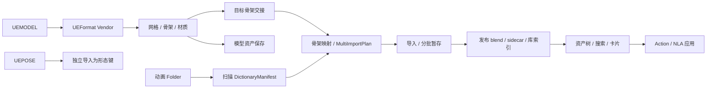

# FModel Tools V2 逐模块功能设计评审

评审日期：2026-09-15。评审对象为当前工作树，包括评审开始时已有的 28 个修改文件；Git 基线为 `5f29a086d472ea881ea7c42ffe8b9b644fc3451f`，插件声明版本为 8.1.0。

后续状态（2026-09-16）：用户已授权修正 UEPOSE 设计。新流程和验证结果见[UEPOSE 当前工作流](<G:/Blender/Blender Scripts Github/FModel-2-Blender-Tools-V2/docs/UEPOSE_WORKFLOW_2026-09-16.md>)；V2 姿势入口已不再依赖下文 F16 所述的旧 Vendor 烘焙路径。本报告的问题清单为修正前的评审记录，其余模块未因本次姿势修正而视为已修复。

格式依据补充：按用户指定，已从 `h4lfheart/UEFormat` 获取完整公开格式文档及当前/legacy 解析源码，固定提交 `d858fe38b2b5b8c63ac4b7481b4386ebfabbf935`。见[上游格式依据与本项目对照][upstream-formats]。本报告中的 FModel 材质、纹理与严格身份能力属于定制扩展；UEPOSE 转为形态键属于 Blender 创建策略，不是二进制格式唯一允许的表示。

UEPOSE 专项复核修正：此前对“独立于 Action 打包”的肯定仅适用于区分姿势与时间序列动画。**只保留网格形态键的唯一输出设计存在范围失误**，需要源姿势数据层和明确的资产应用表示。新增 5 组 Blender 场景已验证无网格失败、多网格遗漏、辅助骨骼/曲线零输出、混合姿势关系丢失，详见[UEPOSE 设计专项评审][uepose-design]。该专项按同一设计问题分析，未加入下列 17 项编号统计。

## 1. 结论

项目的职责划分可以继续沿用：UEFormat Vendor 负责协议和 Blender 数据创建，V2 负责扫描、任务编排、资产库发布及动画管理。严格骨架身份、显式兼容策略、文件发布事务和来源标记都是有价值的设计。

当前主要问题集中在模块交接。实际运行发现，新场景扫描、模型保存、动画辅助曲线保留、来源版本传递和缩略图重建存在功能缺陷。现有自动化测试全部通过，仍不足以说明用户主流程完整可用。

本报告列出 **8 项 P1、8 项 P2、1 项 P3**，共 17 项。P1 表示阻断主要流程或影响资产、现有绑定及链接稳定性；P2 表示特定功能失效或重要设计缺口；P3 表示文档维护问题。此分级不代表所有问题都发生在所有项目中。

本次仅新增评审报告和验证材料，没有修复业务源码。

## 2. 验证范围与证据

| 验证 | 结果 | 能说明什么 |
|---|---|---|
| 现有 pytest 全集 | 529 passed，52 subtests passed，14.08 秒 | 现有纯 Python、模拟 Blender 和源码合同成立 |
| Python AST 语法检查 | 195 个 Python 文件通过 | 已枚举源码无语法错误 |
| Vendor tree manifest | 73 个文件校验通过 | 当前 Vendor 载荷与锁定清单一致 |
| Blender 5.2.1 原生模型冒烟 | 通过 | 仓库 V10 固定样本创建网格、骨架、材质，身份与独立读取器一致 |
| Blender 5.2.1 模块交接观察 | 13 个观察点 | 真实 Blender API 下复现本报告中的主要缺陷 |
| Blender 5.2.1 补充观察 | 3 组业务场景，另验证注册/注销 | 完成任务重跑、目标版本变化、UEPOSE 成功后的状态恢复 |
| UEFormat 官方格式溯源 | 4 份完整格式文档、90 个原始文本参考文件；版本、四个 DTO 和空间转换 AST 相同 | 核对 V0–V10 结构及标准/扩展边界；不代表完整语义保真验收 |

Vendor tree SHA-256：`8027d2864a74650ad452d88c3a494876c8c0f4534f6c85772fbfd5d3987279d2`。

验证使用独立 `--background --factory-startup` 进程、临时目录和合成骨架/动画。已有模型冒烟使用仓库的 `fmodel_v10_full.uemodel`。未对用户正在编辑的场景执行操作。

- [机器可读验证记录][evidence]
- [可重复执行的 Blender 观察脚本][probe]
- [补充 Blender 观察脚本][supplement-probe]；结果并入同一份机器可读记录

观察脚本记录实际结果，不将“复现了缺陷”伪装成通过验收。记录中 `blender_relative_checkpoint_path` 的异常就是路径问题的证据。

未覆盖：真实游戏复杂材质的视觉效果、UEPOSE 真实角色效果、GUI 渲染与交互、万级动画性能和长时间运行。文中的性能分析是调用路径分析，不是实测耗时结论。

## 3. 当前架构与数据流

### 三种“身份”需要明确区分

1. **源骨架身份**：UE 逻辑路径、GUID、骨骼布局 hash。
2. **导入目标身份**：具体 Blender Armature 及影响导入结果的结构、参考姿势和转换参数。
3. **资产实例身份**：库、包路径、Action 名及本地 Append / 外部 Link 的引用性质。

当前严格身份校验已覆盖第一类，来源标记和事务覆盖了第三类的大部分需求。显示名、临时文件名、目标结构版本和引用模式仍存在混用。

## 4. 逐模块检查

| 模块 | 当前职责与设计评价 | 主要结论 |
|---|---|---|
| 插件入口、生命周期 | 分层注册；Vendor 延迟 headless 注册；handler/timer 有代际与所有权管理 | 实际注册、注销通过。后续补充“注册中途失败后再启用”的集成验证 |
| UEFormat 桥接、Vendor 加载 | 按具体能力检测；wheel 匹配 Python ABI；校验树摘要；缓存和加载失败有回滚 | 边界清楚，适合继续作为唯一协议实现。V2 不宜另写一套完整导入器 |
| 原生模型导入 | 统一导入选项、Datablock 事务、骨架 provenance、导入后交接、Last Operation | 固定样本通过。材质/纹理 warning 尚未完整汇入统一操作报告 |
| 材质与纹理 | Vendor 负责材质槽映射、PBR 参数、外部/嵌入纹理、内容与色彩解释缓存 | 功能设计较完整。应明确“成功导入几何体”与“材质缺失/降级”的报告差异；复杂游戏材质仍需实物验证 |
| 单独 UEANIM / UEPOSE 导入 | 显式目标骨架；严格身份默认；名称兼容可选；批量统计部分成功 | UEPOSE 唯一输出为形态键的设计范围过窄，缺少源姿势及组合曲线保留，见专项评审；成功后还会清零已有骨骼姿势（F16）。需要显示有效产出及跳过原因 |
| Folder 扫描与向导 | 4 步 UI；底层 5 阶段，其中格式中转为原生格式直通；姿势资源单独统计 | 新场景扫描结果读取失败（F01）；Blender 相对路径未统一（F07）；只有一种流程时第 1 步可简化 |
| 骨架匹配与多任务计划 | 严格身份预检、显式多骨架映射、每任务 checkpoint | 骨架别名与暂存文件校验冲突（F06）；completed 状态缺少产物/后处理复核（F15）；目标结构摘要遗漏参考姿势与转换参数（F17）。扫描分组仍以叶名为 key，不足以区分不同 UE 路径下的同名骨架 |
| 批量动画导入与恢复 | 自适应批次、暂存落盘、失败报告、任务身份校验 | 版本信息在暂存时丢失（F02）；辅助曲线及原形态键绑定处理不完整（F03）；内存和 hash 调用仍有规模风险（F13） |
| 动画库发布与元数据修复 | blend/sidecar/index 事务；完整来源集合检查；稳定包路径更新；显式修复 | 发布事务基础较好，但上游丢失版本使增量合同退化；缩略图重建绕进强制重建路径（F05） |
| 动画浏览与检索 | 库优先树、分卷、骨架过滤、祖先目录搜索、分页、来源 key | UI 读取不再隐式加载 Action 是合理的。详情元数据应写入库索引，避免未加载时看不到帧数/时长；缩略图缓存需有内容版本失效机制 |
| 动画预览、应用与 NLA | 应用前校验身份；Action slot 适配；失败回滚 | Link 可能复用本地副本（F08）；NLA 覆盖文案与实际拒绝策略冲突（F09）；时间基准未贯穿导入、恢复、应用（F12） |
| 模型资产库 | 保存角色、骨骼信息、预览、浏览及 Link 导入 | 保存产物遗漏网格（F04）。还应统一模型包清单、覆盖写入事务、引用模式及可编辑角色的导入策略 |
| 通用骨架 / 网格 / 动画工具 | 骨架分组、重命名、映射、镜像；形态键清理与材质分离；Action 清理 | 骨架遍历短路（F11）；导入后清理仍拒绝有 slot 的 Action（F10）。独立清理器已支持 channelbag |
| Shader 独立脚本、文档、同步发布 | 手动节点脚本；运行时同步排除文档/测试/备份；Vendor 摘要锁定 | Shader 脚本没有加入活动注册链；GameProfile/旧材质修复文档与当前目录不符（F14）。同步脚本默认是实际安装动作，评审未运行安装 |

### 通用工具还应补齐的功能约束

- 骨骼映射应指定某一个映射文本。目前 `SKEL_OT_MapBoneNames` 遍历所有 Blender Text，其中任意 `旧名=新名` 都可能成为映射输入。
- 骨骼批量重命名应预检重名、选中范围和对已有动画的影响，并使目标版本失效。
- `armature_identity()` 的结构摘要目前只有骨名和父名。已补充真实 Blender 验证，见 F17。
- 网格工具的批量循环应恢复活动对象、选择和模式；形态键判空应明确相对 Basis 还是相对 `relative_key`。
- `Universal_tools/Animations/utils_anim.py` 中的整批动画迁移、全局孤立数据清理没有活动 UI 调用。应标记为内部/历史工具，避免被误认为正式重定向能力。

### 按上游完整格式补充的设计边界

标准本身还定义了加法动画及参考姿势元数据、通用浮点曲线、切线、副法线符号、UV 名称等。当前 parser 覆盖全部 21 个 V10 属性分支，但创建层未完整求值或保留其中部分语义。不能仅凭导入成功断言完整支持这些能力。具体字段、历史版本变化、上游与本项目共同存在的实现局限，见[格式对照第 7 节][upstream-formats]；这些补充尚未做游戏样本视觉验收，不计入下列 17 项已分级问题。

## 5. 已确认的问题

### F01 · P1 · 新场景的扫描流程读取不到已完成的扫描结果

**复现**：新 Blender 场景中填写有效动画目录、输出目录和库名，执行 Step 3。

**实际结果**：磁盘 checkpoint 已存在，包含 `SK_Review` 扫描结果；向导却报告“扫描失败：未生成字典清单”，`scan_completed=False`。

**原因**：[Step 3][scan-read] 仍调用 `load_from_blender_text()`；[持久化接口][checkpoint-write] 已改为只写磁盘。[文本读取入口][text-read] 在 Text 不存在时立即返回，无法走到磁盘回退。调试面板、导出上下文也沿用该旧入口；“清空上下文”仅删除 Text，不能清除实际磁盘恢复状态。

**建议**：提供一个基于规范化输出目录的统一上下文加载接口；扫描、导出、调试和重置均调用它。验收必须从没有 `PipelineContext` Text 的新场景开始。

### F02 · P1 · 分批暂存丢失来源版本，破坏增量更新依据

**复现**：正常导入一个动画，经过落盘再建立资产库。

**实际结果**：导入记录的 `source_version` 消失，最终 manifest 中出现 `source_versions: {"SK_Review::ReviewMove.ueanim": {}}`。

**原因**：首次创建 `ImportedAction` 时记录了源内容、设置、目标版本；[转换为 staged 记录][staged-record] 时重新构造对象，未传递 `source_version`。后续构建直接写入该空版本。

**影响**：已发布资源被归为“版本待校验”，增量判断和目标骨架版本保护缺少依据。`_stable_update_chunks()` 对两个空版本取出的 `target` 都是 `None`，不能据此确认目标未变。

**建议**：以保留完整记录的方式改变导入状态；在正式发布边界要求当前原生导入记录具有完整版本。验收覆盖初次构建、源未变、内容变化、参数变化和目标变化。

### F03 · P1 · 辅助 Curve 动作未进入正式资产包，现有形态键动画绑定被清空

**复现**：角色具有 `Smile` 形态键和已有形态键 Action，启用 `import_curves`，导入同时包含骨骼轨道与 Smile Curve 的动画并打包。

**实际结果**：暂存文件写入两个 Action，正式库只包含 `ReviewMove`；`ReviewMove_Curves` 未发布。角色原形态键 Action 的绑定从 `ReviewRig_MeshDataAction` 变成 `None`。原 Action 数据仍在，但角色已不再使用它。

**原因**：Vendor 的 [Curve 导入][curve-create] 会创建并绑定独立的形态键 Action。V2 只将主 Action 写入 `ImportedAssetCollection`，辅助 Action 只存在于一次导入的内存字典；暂存卸载后无法恢复主/辅助关系。外层 `finally` 只恢复 Armature 的 Action/slot。

**建议**：将一个动画资产建模为主骨骼 Action、辅助 Curve Action 和绑定目标的集合。完整保存形态键 Action/slot/值/名称的前态；发布和应用都消费同一组关系。验收检查包内动作清单和导入前后角色绑定。

### F04 · P1 · “保存模型”产物只有骨架

**复现**：一个 Armature 带一个子 Mesh，执行保存模型。

**实际结果**：函数返回 `True`；保存文件内只有 `ReviewModel__ReviewRig`，`meshes=[]`。源角色确实有 `ReviewRig_Mesh`。

**原因**：[保存逻辑][model-duplicate] 先取消所有选择，再只选骨架执行 `object.duplicate()`，随后遍历复制骨架的 children。源 Mesh 没有被复制到该骨架下。

**建议**：先确定角色对象集合，再复制或写出整套角色依赖；同时覆盖“父子关系绑定”和“仅 Armature modifier 绑定”。发布前读取产物清单，检查网格数、骨架和材质，随后在新场景完成回读验收。

### F05 · P1 · “重新生成缩略图”改变资产包路径

**复现**：建立单骨架资产库，再执行“重新生成缩略图”。

**实际结果**：返回 `FINISHED`，包从 `Review_SK_Review.blend` 变为 `Review_SK_Review_Vol_2.blend`。旧包路径不再保留。本次初次构建关闭缩略图，重烘焙仍保留该旧配置，最终没有生成 WebP，却报告“缩略图已更新”。

**原因**：[重烘焙 operator][rebake-force] 设置 `force_rebuild=True` 并执行完整 `LibraryBuildingStage`；后者分配新卷并清理旧包。该入口还没有将当前缩略图选项同步到执行配置。多骨架计划则直接拒绝单独重烘焙。

**建议**：增加独立缩略图任务，明确读取当前渲染参数，保留包路径、Action 名和来源版本，只事务更新缩略图及相关元数据。验收需在另一个保存了 Link 引用的场景中验证链接仍能加载。

### F06 · P1 · 骨架显示别名导致暂存校验失败

**复现**：资源身份为 `/Game/Review/SK_Review`，目标具有完全相同的原生身份，但 `FModel_Skeleton` 显示属性设为 `Review`。

**实际结果**：原生动画导入成功，落盘 `Review_chunk_0001.blend`，随后被拒绝为“暂存动作包路径无效”；保存后的 checkpoint 也无法读取。

**原因**：[写入暂存时][staging-write-name] 使用目标显示名，而 [暂存校验][staging-validation] 要求文件名前缀是来源清单里的骨架名 `SK_Review`。名称兼容模式下源、目标不同名也会遇到这类冲突。

**建议**：统一暂存路径的身份合同，使用任务身份或稳定的源骨架标识。显示别名只用于显示/筛选。再将扫描分组 key 从骨架叶名升级为完整来源身份，以允许不同目录下的同名骨架独立映射。

### F07 · P1 · Blender `//` 相对路径进入了普通文件系统接口

**证据**：真实 Blender 中调用 `_checkpoint_path_for_output('//ReviewOutput')` 抛出 `pipeline checkpoint path escapes output directory`。向导配置直接保存原始 `state.output_dir`，调用链确实可将这种值传入该接口。

**原因**：[checkpoint 路径构造][checkpoint-path] 使用 `os.path.abspath()`，没有先解释 Blender 的 `//` 语义。扫描和打包的部分代码使用了 `bpy.path.abspath()`，所以同一配置在不同阶段的路径解释不一致。

**建议**：Blender 边界统一解析 source/output/bundle 路径，核心层只接受绝对路径。验收覆盖已保存工程的相对目录、绝对目录、跨盘路径，以及未保存工程的处理规则。

### F08 · P2 · 从 Append 切到 Link 会继续复用本地 Action

**实测**：同一资产先 `_load_action_for_item(..., use_link=False)` 再 `use_link=True`，两次返回同一个 Datablock，第二次 `action.library` 仍为空。

**原因**：[Link 的兜底复用分支][link-local] 只验证来源标记，没有要求候选 Action 实际来自外部 library。

**建议**：引用性质应成为选择条件。Link 仅复用真实链接对象，否则从指定包建立链接；Append 始终明确创建本地副本。界面显示当前绑定的实际性质。

### F09 · P2 · NLA 覆盖选项与执行合同不一致

**实测**：对已有重叠 strip 执行覆盖，返回 `cannot safely replace existing NLA strips`，旧 strip 保留。

**原因**：[安全函数][nla-reject] 明确拒绝任何重叠覆盖，而 UI 仍承诺“删除全部重叠/仅删同名重叠”。此外 [目标轨道选择][nla-track] 使用最后一条轨道，并未读取活动轨道；REPLACE 在任何 NLA track 存在时都会拒绝。

**建议**：将可支持的追加、插入、覆盖范围写成明确合同。可先隐藏未实现的覆盖选项，或仅为能够完整恢复的 strip 类型实现事务覆盖；目标轨道由用户明确选择。保留目前拒绝破坏不可恢复 strip 的保护。

### F10 · P2 · 导入后的动作清理仍跳过 Blender 5 slot 动作

**实测**：配置 `clean_after_import=True` 后，日志对主 Action 和 Curve Action 都报告“跳过不支持 Blender 5 slots 的旧式动作清理”。

**原因**：[管线清理门禁][cleanup-gate] 仍使用 `supports_legacy_cleanup()`，但独立 `clean_action()` 已支持 `layers/strips/channelbags`。新能力没有接到调用链上。

**建议**：统一清理能力检测，明确支持的容器，增加真实原生导入后清理的检查。当前清理算法主要处理空通道和平坦通道，产品文案不应暗示已实现通用曲线降采样。

### F11 · P2 · 骨架整理漏遍历分支，隐藏有权重的骨骼

**实测**：root 下有 left/right，两者均被网格顶点组使用；运行整理后 right 被放进隐藏辅助集合。

**原因**：[递归判断][bone-sort] 使用 `any(check(c) for c in bone.children)`。遇到第一个有用子骨骼即短路，后续子树没有机会写入 `useful` 集合。

**建议**：遍历完所有子树后再归并布尔结果。验收至少包含两个有权重兄弟节点、深层链、无网格和只通过 modifier 绑定的角色。

### F12 · P2 · 帧率没有进入恢复和资产应用合同

**证据**：Vendor 根据当前场景 FPS/FPS base 将源 tick 换成 Blender 帧。本次 30 FPS、1 秒源动画保存为 `[0, 24]`。把场景改为 60 FPS 后，导入设置指纹完全不变；资产应用也没有按保存时的 FPS 重定时。

**影响**：恢复可能复用基于旧场景帧率导入的结果；跨帧率场景直接应用会改变实际播放时长。24 帧间隔在 60 FPS 场景中是 0.4 秒。

**建议**：将有效帧率纳入导入指纹及库元数据；明确库保存采用统一帧率还是保留时间单位。Append 可创建重定时副本，Link/NLA 应通过合适的 strip 时间映射保持秒数。UI 时长计算也应考虑 `fps_base`。

定位：[Vendor 时间换算][anim-time]、[导入指纹][import-fingerprint]。

### F13 · P2 · 批次设计尚未贯穿到构建和验证，存在规模风险

以下为静态调用路径确认，尚未进行万级动画性能测量：

- 导入结束后，[完整性检查][reload-all] 逐个重新加载全部 staged 主 Action，回升为全量驻留；构建开始也先解析全部动作，再逐卷写出。
- `_validate_staged_blend()` 计算任务暂存目录时重新调用 `_task_identity()`；后者对完整 `source_subset` 求来源版本并读取文件内容。逐个恢复 N 个 Action 时会重复处理整批来源，具有平方级重复读取的路径。
- `source_revision()` 已读取内容 hash，但扫描记录的 `content_hash` 仍为空；计划、预检、任务目录和发布各层重复求值。
- Stage 在普通 operator `execute()` 中同步执行，批次参数控制内存分组，不能提供用户可响应的暂停/取消。一次达到循环上限表现为失败。

**建议**：每次运行计算一次不可变任务身份；按暂存包批量验证与加载、写出后释放；保留检测源文件变化的必要检查。将耗时工作拆成可恢复步骤，Blender Datablock 操作仍由主线程执行。用真实 1k/10k 资产记录峰值内存、读盘字节、hash 次数及取消延迟。

### F14 · P3 · 当前功能文档包含已移除入口

`README_ZH.md` 同时说明旧材质管理器退役，又宣传 `GameProfile` 管理器，并称 `Universal_tools/material` 仍保留。当前目录与注册链没有这些模块。结构文档还列出已不存在的旧格式/索引源码及旧 Vendor 版本。

`Shaders/Tools Nodes/TOOL_NODES.md` 对 FlipNormalY 的内部公式描述也与当前脚本不一致；脚本实际对绿色通道执行 `1-G`。

**建议**：以注册链和同步载荷生成活动能力清单；当前使用说明仅保留可触达功能，历史设计放在带状态标记的独立文档。避免用户沿 README 寻找不存在的入口。

### F15 · P1 · 已完成任务跳过产物复核及新启用的模型保存

**实测**：通过真实向导 runner 完成一次扫描、导入和打包，得到 `ResumeReview_SK_Review.blend`。随后验证：

1. 开启“同时保存模型”再运行，返回成功，但 `prepare_task` 回调调用次数为 0。
2. 将输出包移出其原路径，保留 checkpoint 和索引；再次运行返回成功，没有重新生成任何 `.blend`。
3. 缺包时继续运行 Finalization，仍返回成功。
4. 关闭“断点续传”再运行，仍返回成功且没有产物。

**原因**：[任务恢复][restore-task] 按 `task_id` 复用 `completed`；[执行器][skip-completed] 直接跳过此状态，未核验最终包。`lib_save_model` / `lib_model_preview` 不进入 wizard config 和构建指纹，保存模型又位于被跳过的 task 回调内。禁用 resume 仅清除导入 checkpoint，没有重置完成任务；Finalization 校验库目录存在并扫描，未要求已承诺的输出包存在。

**影响**：UI 的成功状态不能代表请求的产物完整。恢复入口无法自动修复缺失包，新增后处理要求也可能无声失效。

**建议**：将导入完成、发布完成、模型保存和缩略图完成分别记录；恢复时核对产物清单及对应设置版本，按缺失部分重做。定义关闭断点续传的明确语义，并让任务级状态遵守它。Finalization 应基于期望产物验收，不能把“扫描成功但零产物”视为完整成功。

### F16 · P2 · UEPOSE 成功后不恢复角色原有姿势

**实测**：将 right 骨骼位置设为 `[0, 0.25, 0.5]`，导入只作用于 left 的合成姿势。`ReviewPose` 形态键成功生成，但 right 的位置变为 `[0, 0, 0]`。再次导入相同姿势新增 `ReviewPose.001`。

**原因**：`create_pose()` 保存了原有 `matrix_basis`，在 finally 中清零所有骨骼变换，却[仅在失败时恢复矩阵][pose-restore]。成功路径会恢复约束开关和已有形态键数值，但没有恢复骨骼姿势。

**建议**：将形态键生成视为对模型的编辑，同时恢复临时使用的骨骼姿势、选择及模式；成功和失败都应遵守明确的场景状态合同。重复导入的自动后缀不是本条缺陷的判定依据，但应明确支持追加、按来源更新还是跳过，避免用户误以为重新导入会更新原姿势。

本次通过 Vendor 的 `create_pose()` 和合成 DTO 验证状态恢复，未验证真实游戏 UEPOSE 文件的最终面部视觉效果。

### F17 · P2 · 目标参考姿势和转换属性变化不会使恢复身份失效

**实测**：在 Blender Edit Mode 中将 left 骨骼头部从 `[1, 0, 0]` 移至 `[3, 0, 0]`，同时移动尾部，并设置 `orig_loc` / `post_quat`。`armature_identity()` 返回的 stable ID 和 structure revision 均保持不变。

**原因**：[结构摘要][target-revision] 只包含骨名与父名；而 Vendor 的动画创建会实际读取 `orig_loc`、`orig_quat`、`post_quat` 计算位置和旋转。源骨架 provenance 说明资源来源，不能替代当前 Blender 目标的转换参数版本。

**影响**：即便源文件、源骨架身份和导入选项都没变，用户修改目标参考数据后也可能需要重导入；当前任务身份无法识别这种变化。此项确认了版本检测缺口，没有把未实测的具体游戏动画偏差作为证据。

**建议**：对真正影响导入结果的目标数据计算确定性摘要，包括所采用的参考变换和 Vendor 转换属性；避免把与结果无关的显示状态算入。将其同时用于任务恢复和发布来源版本。验收应比较“改目标后恢复”与“改目标后全新导入”的输出曲线。

## 6. 建议的修复顺序

### 第一批：恢复可靠的用户主流程

1. 统一 checkpoint 加载、路径解释和重置合同，修复 F01/F07；完成状态增加产物核验及后处理失效规则（F15）。
2. 统一来源/目标/暂存身份，完整传递版本，修复 F02/F06。
3. 完整保存动画辅助关系和角色状态，修复 F03；修复模型保存并完成回读验收（F04）。
4. 将缩略图任务从重建发布中拆出，修复 F05。

### 第二批：兑现动画管理选项

修复 Link/Append、NLA 目标与覆盖范围、slot 清理、骨架分支遍历和帧率合同（F08–F12），以及 UEPOSE 场景恢复和目标数据版本（F16/F17）。这些修复应分别有用户行为层面的验收，不能仅检测某个函数名或参数是否存在。

### 第三批：规模、报告和文档

- 让批次贯穿导入、验证、打包与释放，减少完整来源集合的重复计算。
- 统一 ImportSession、PipelineContext 日志和 Vendor warnings。将“本次只完成几何体”“缺贴图”“无可应用曲线”“发布成功但缩略图失败”等结果准确展示给用户。
- 向库索引增加帧数、有效 FPS、时长和兼容性摘要，让浏览详情无需加载 Action。
- 统一缩略图生成后的扫描/图标缓存失效机制。当前动画图标一旦按路径缓存，扫描不会自动使同路径新图片重新加载；模型的“刷新列表”也未清理图标缓存。
- 精简重复入口、空操作阶段和未接入 UI 的配置；同步 README 和当前合同。

## 7. 测试设计建议

当前测试对纯逻辑和安全边界覆盖较广。缺陷集中在“单个函数看起来正确，真实调用链连接后失效”的位置。例如 staged 状态转换、只存在磁盘 checkpoint 的新场景、选择骨架后的实际复制行为、先 Append 再 Link。

优先将本次观察场景固化为少量真实 Blender 集成验收：

1. 无 Text 的新场景：原生模型导入 → 骨架交接 → Folder 扫描 → 打包 → 资产应用。
2. 一个骨骼 Action 加一个 Shape Key Action：导入前态、暂存、checkpoint、最终包、重新应用全链一致。
3. 模型保存 → 新场景加载：角色对象数量、网格、骨架 modifier、材质与纹理依赖完整。
4. 不同显示别名、不同场景帧率、Windows/Blender 相对路径。
5. 已保存 Link 场景：增量更新和仅重烘焙之后，原包路径与 Action 名保持有效。
6. 完成任务后移动产物、开启模型保存、关闭断点续传：分别验证实际重新执行范围和最终文件，而不只看返回状态。
7. 带已有骨骼姿势的 UEPOSE 导入；修改目标参考数据后，对比恢复导入与全新导入的结果。

现有 529 项测试应继续保留，真实 Blender 验收用于补充其不能覆盖的模块交接行为。

[evidence]: <G:/Blender/Blender Scripts Github/FModel-2-Blender-Tools-V2/docs/compose/reports/2026-09-15-module-design-evidence.json>
[upstream-formats]: <G:/Blender/Blender Scripts Github/FModel-2-Blender-Tools-V2/docs/UEFORMAT_UPSTREAM_FORMAT_REFERENCE_2026-09-15.md>
[uepose-design]: <G:/Blender/Blender Scripts Github/FModel-2-Blender-Tools-V2/docs/UEPOSE_DESIGN_REVIEW_2026-09-15.md>
[probe]: <G:/Blender/Blender Scripts Github/FModel-2-Blender-Tools-V2/docs/compose/reports/2026-09-15-module-design-probe.py>
[supplement-probe]: <G:/Blender/Blender Scripts Github/FModel-2-Blender-Tools-V2/docs/compose/reports/2026-09-15-module-design-supplement-probe.py>
[restore-task]: <G:/Blender/Blender Scripts Github/FModel-2-Blender-Tools-V2/core/multi_import.py:138>
[skip-completed]: <G:/Blender/Blender Scripts Github/FModel-2-Blender-Tools-V2/core/multi_import.py:170>
[pose-restore]: <G:/Blender/Blender Scripts Github/FModel-2-Blender-Tools-V2/vendor/io_scene_ueformat/importer/create/pose.py:233>
[target-revision]: <G:/Blender/Blender Scripts Github/FModel-2-Blender-Tools-V2/core/resume.py:111>
[scan-read]: <G:/Blender/Blender Scripts Github/FModel-2-Blender-Tools-V2/Fmodel/Pipeline/steps/step3_scan.py:66>
[checkpoint-write]: <G:/Blender/Blender Scripts Github/FModel-2-Blender-Tools-V2/core/context.py:377>
[text-read]: <G:/Blender/Blender Scripts Github/FModel-2-Blender-Tools-V2/core/context.py:560>
[staged-record]: <G:/Blender/Blender Scripts Github/FModel-2-Blender-Tools-V2/Fmodel/Pipeline/stages.py:1163>
[curve-create]: <G:/Blender/Blender Scripts Github/FModel-2-Blender-Tools-V2/vendor/io_scene_ueformat/importer/create/anim.py:225>
[model-duplicate]: <G:/Blender/Blender Scripts Github/FModel-2-Blender-Tools-V2/Assets/Models/operators.py:98>
[rebake-force]: <G:/Blender/Blender Scripts Github/FModel-2-Blender-Tools-V2/Fmodel/Pipeline/steps/step4_import.py:154>
[staging-write-name]: <G:/Blender/Blender Scripts Github/FModel-2-Blender-Tools-V2/Fmodel/Pipeline/stages.py:1335>
[staging-validation]: <G:/Blender/Blender Scripts Github/FModel-2-Blender-Tools-V2/Fmodel/Pipeline/stages.py:357>
[checkpoint-path]: <G:/Blender/Blender Scripts Github/FModel-2-Blender-Tools-V2/core/context.py:324>
[link-local]: <G:/Blender/Blender Scripts Github/FModel-2-Blender-Tools-V2/Assets/Anims/anim_manager.py:560>
[nla-reject]: <G:/Blender/Blender Scripts Github/FModel-2-Blender-Tools-V2/core/action_safety.py:249>
[nla-track]: <G:/Blender/Blender Scripts Github/FModel-2-Blender-Tools-V2/Assets/Anims/anim_manager.py:1208>
[cleanup-gate]: <G:/Blender/Blender Scripts Github/FModel-2-Blender-Tools-V2/Fmodel/Pipeline/stages.py:1089>
[bone-sort]: <G:/Blender/Blender Scripts Github/FModel-2-Blender-Tools-V2/Universal_tools/skeleton/__init__.py:50>
[anim-time]: <G:/Blender/Blender Scripts Github/FModel-2-Blender-Tools-V2/vendor/io_scene_ueformat/importer/create/anim.py:106>
[import-fingerprint]: <G:/Blender/Blender Scripts Github/FModel-2-Blender-Tools-V2/core/resume.py:11>
[reload-all]: <G:/Blender/Blender Scripts Github/FModel-2-Blender-Tools-V2/Fmodel/Pipeline/stages.py:1363>
