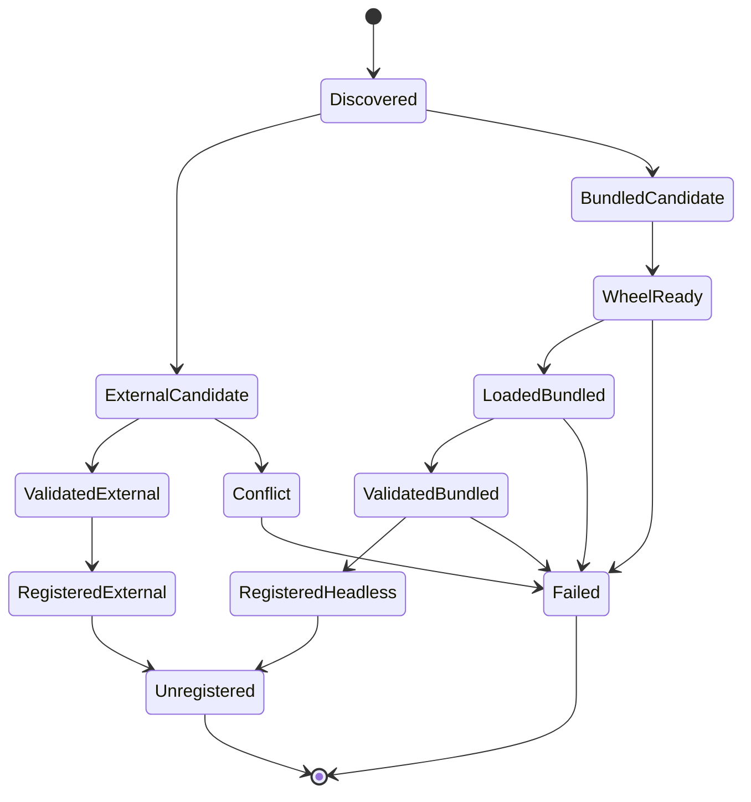

# UEFormat Vendor 内置架构方案（历史设计，当前实现已落地）

更新时间：2026-08-07（当前状态修订于 2026-08-13）  
目标项目：`F:\Blender Scripts Github\FModel-2-Blender-Tools-V2`

> 当前实现已经落地 Vendor Loader、hash/lock/cache、headless 注册、能力桥和冲突 fail-closed 策略。
> 当前 Vendor 只负责 `.uemodel/.ueanim/.uepose`；官方 USD 负责世界场景。UESCENE、Project Index
> 和旧格式依赖不属于当前 Vendor 发布合同。本文中未落地的 package rename、旧 smoke matrix
> 和旧 Project Index 路径仅保留为历史设计背景。

## 1. 结论

建议将 `io_scene_ueformat` 从“另一个会被 Blender 当成独立插件的副本”调整为：

> **FModel Tools 的私有 UEFormat runtime dependency**

它属于 FModel Tools 的实现依赖，不应该在用户的 Blender Preferences 中作为第二个独立插件启用，也不应该创建第二套 canonical UEFormat 面板。

当前实现已经能工作，但仍然偏向“把 Vendor 目录临时加入 `sys.path`，再按模块名 `io_scene_ueformat` 导入”：

```text
F:\Blender Scripts Github\FModel-2-Blender-Tools-V2\auto_handlers.py
        │
        ├── 插入 vendor 父目录到 sys.path
        ├── 解压 zstandard wheel 到系统 temp cache
        ├── __import__("io_scene_ueformat")
        └── register_headless()
```

这适合开发和过渡阶段，但不是最终发行形态。最终应该把 **加载、版本、依赖、注册、注销和外部插件冲突** 统一交给一个 Vendor Loader。

## 2. 当前方案的问题

### 2.1 模块名冲突

内置模块和用户独立安装的插件都叫：

```text
io_scene_ueformat
```

Python 的 `sys.modules` 是进程级缓存。即使当前代码通过路径检查避免了部分误导，下面情况仍然容易变得复杂：

- 外部插件已经被导入但尚未启用；
- Blender 热重载后旧模块仍留在 `sys.modules`；
- 同名模块先后来自不同目录；
- 外部插件版本不满足 V2 contract，但类已经注册；
- 卸载时当前模块对象已经被另一个同名模块替换。

### 2.2 依赖安装目录不稳定

当前 zstandard wheel 会解压到：

```text
%TEMP%\fmodel_wheel_cache\
```

这会带来：

- 临时目录清理导致下次重新解压；
- 不同 FModel 版本共用同名缓存；
- wheel 内容更新但目录名不变时无法可靠失效；
- 多 Blender 实例同时启动时没有锁和原子发布；
- 运行时文件不属于 FModel 的用户配置/缓存范围。

### 2.3 Vendor manifest 边界不清晰

当前 Vendor 自己有：

```text
F:\Blender Scripts Github\FModel-2-Blender-Tools-V2\vendor\io_scene_ueformat\blender_manifest.toml
```

但 FModel 根目录没有对应的 `blender_manifest.toml`。这意味着该 manifest 目前只是 Vendor provenance，不会自动把 Vendor 当成一个可独立管理的 Blender extension dependency。

如果把 Vendor 真正装成独立插件，就会重新产生重复面板、重复菜单、版本冲突和用户配置冲突；如果作为 FModel 内置 runtime，则应该由 FModel 根包统一打包和管理。

### 2.4 注册与加载职责混在一起

当前 `auto_handlers.py` 同时负责：

- 发现外部插件；
- 选择 Vendor；
- 安装 wheel；
- 修改 `sys.path`；
- 导入模块；
- 判断能力；
- 调用 `register_headless()`；
- 记录注销对象。

后续再增加 Vendor 或版本策略会继续扩大这个文件的复杂度。

## 3. 推荐的最终目录

建议下一阶段改成私有包名，避免把内置副本暴露成外部 canonical module：

```text
F:\Blender Scripts Github\FModel-2-Blender-Tools-V2\vendor\
├── fmodel_ueformat_runtime\
│   ├── __init__.py
│   ├── importer\
│   ├── op\
│   ├── options.py
│   ├── logging.py
│   └── typing.py
├── runtime\
│   └── wheels\
│       ├── zstandard-0.25.0-cp311-cp311-win_amd64.whl
│       ├── zstandard-0.25.0-cp312-cp312-win_amd64.whl
│       └── zstandard-0.25.0-cp313-cp313-win_amd64.whl
├── vendor_manifest.toml
└── README.md
```

建议的私有导入名：

```text
fmodel_ueformat_runtime
```

而不是：

```text
io_scene_ueformat
```

Blender operator id 仍然可以保持 Vendor 原有的：

```text
uf.import_uemodel
uf.import_ueanim
uf.import_uepose
uf.import_uescene
```

因为 operator id 和 Python package name 是两个不同层次的合同。

## 4. Vendor Loader 设计

新增：

```text
F:\Blender Scripts Github\FModel-2-Blender-Tools-V2\core\vendor_loader.py
```

核心对象建议为：

```python
@dataclass(frozen=True)
class VendorSpec:
    vendor_id: str
    package_name: str
    version: tuple[int, ...]
    source_path: Path
    wheels_path: Path
    required_capabilities: tuple[str, ...]

@dataclass
class VendorHandle:
    spec: VendorSpec
    module: ModuleType
    source: str  # "bundled" or "external"
    registered: bool = False
    registration_mode: str = "headless"
    added_paths: tuple[Path, ...] = ()
    cache_root: Path | None = None
```

Loader API：

```python
def load_ueformat_vendor() -> VendorHandle:
    ...

def register_ueformat_vendor(handle: VendorHandle) -> None:
    ...

def unregister_ueformat_vendor(handle: VendorHandle) -> None:
    ...

def inspect_ueformat_vendor(handle: VendorHandle) -> UEFormatCapabilities:
    ...
```

`auto_handlers.py` 只保留生命周期调用：

```python
handle = load_ueformat_vendor()
register_ueformat_vendor(handle)
...
unregister_ueformat_vendor(handle)
```

这样 Vendor 选择、依赖缓存和注册错误不会继续堆积在自动处理器中。

## 5. 外部插件优先级策略

建议采用确定性策略，而不是两个同名插件同时尝试注册：

### 情况 A：用户已启用外部当前 UEFormat

- 检查外部插件版本和 capability contract；
- 满足当前 FModel material/texture/strict skeleton 能力时使用外部插件；
- 不加载内置 Vendor；
- 不自动调用外部插件的 headless wrapper；用户自己安装的插件保留其 UI。

### 情况 B：用户没有启用外部 UEFormat

- 加载私有内置 package `fmodel_ueformat_runtime`；
- 加载兼容 zstandard wheel；
- 只调用 `register_headless()`；
- 记录 `VendorHandle(source="bundled")`。

### 情况 C：用户启用了外部旧版 UEFormat

建议直接报告错误：

```text
检测到已启用但不满足 FModel contract 的外部 io_scene_ueformat。
请升级或禁用外部插件后使用 FModel 内置 Vendor。
```

不建议在同一个 Blender 进程中同时加载外部旧版和内置新版，因为两者会竞争相同的 `uf.*` operator、Scene property 和 file handler。

### 情况 D：同名模块已经在 sys.modules

Loader 必须检查模块来源和能力：

- 来源为当前外部 addon 且 contract 合格：使用外部；
- 来源为旧版或未知路径：不复用；
- 内置 runtime 以私有 package name 加载，避免覆盖 `sys.modules["io_scene_ueformat"]`。

## 6. zstandard wheel 缓存策略

不要继续把运行时依赖解压到普通系统 temp。建议使用 Blender 用户资源目录下的 FModel 专用缓存：

```text
<Blender user resource>/fmodel_tools/vendor-cache/
└── io_scene_ueformat/
    └── zstandard-0.25.0/
        └── cp313-win_amd64/
            └── <sha256>/
```

每个缓存目录应包含：

```text
_extracted.ok
vendor.lock
zstandard package files
```

`vendor.lock` 记录：

```toml
vendor_id = "io_scene_ueformat"
vendor_version = "1.1.5"
wheel = "zstandard-0.25.0-cp313-cp313-win_amd64.whl"
sha256 = "..."
python_tag = "cp313"
platform_tag = "win_amd64"
```

加载流程：

1. 判断 Python ABI 和平台；
2. 读取内置 wheel；
3. 校验 SHA-256；
4. 检查缓存目录中的 lock；
5. 使用临时目录解压；
6. 校验成功后原子 rename 到最终 hash 目录；
7. 只把该版本缓存路径放入 `sys.path`；
8. 记录到 `VendorHandle.added_paths`。

这样系统 temp 只承担短暂的原子解压过程，正式运行时文件进入 FModel 专用缓存。

## 7. Release 打包方式

### 当前阶段建议

继续使用传统 Blender Add-on 目录安装，但发行时只提供一个 FModel 包：

```text
FModel_Tools/
├── __init__.py
├── auto_handlers.py
├── core/
├── Fmodel/
├── Assets/
├── Universal_tools/
├── vendor/
│   ├── fmodel_ueformat_runtime/
│   ├── runtime/
│   └── vendor_manifest.toml
└── README.md
```

不要把 Vendor 另打成用户需要单独安装的 `io_scene_ueformat.zip`。

### 后续如果迁移 Blender Extensions

如果将来把 FModel 本身改成 Blender extension：

- manifest 应位于 FModel 根目录；
- Vendor 作为 FModel 包内 runtime，而不是嵌套的第二个 extension；
- nested `blender_manifest.toml` 不应被当作第二个可安装插件；
- 发行审计应检查只存在一个 FModel extension identity。

## 8. 迁移阶段

### Phase A：Loader 抽取

- 从 `auto_handlers.py` 提取 Vendor Loader；
- 保持现有 `vendor/io_scene_ueformat` 路径不变；
- 先实现 `VendorHandle`、wheel hash、用户缓存和测试；
- 不改变运行时模块名。

### Phase B：私有包名

- 将内置包迁移为 `vendor/fmodel_ueformat_runtime`；
- 更新 `core/ueformat_bridge.py` 使用模块对象/handle，而不是硬编码 import name；
- 更新 model/animation/scene operators 获取 bridge 的方式；
- 增加外部旧版冲突测试；
- 保持 Blender operator id 和 FModel 用户 API 不变。

### Phase C：移除旧 Vendor

在 Blender 5.2 手动验证完成后：

- 删除 `vendor/io_scene_psk_psa`（已在当前清理阶段完成）；
- 删除旧格式 source files；
- release archive 只携带 UEFormat runtime；
- 更新 Vendor lock 和 license inventory。

## 9. 不建议的方案

### 不建议：继续把 Vendor 当独立插件安装

会导致：

- 重复面板；
- 重复 File > Import 菜单；
- 两套 `UFSettings`；
- 外部和内置版本不可预测；
- 用户需要自己判断哪个插件应该启用。

### 不建议：永远使用 `sys.path.insert(0, vendor_parent)`

它对开发目录有效，但会把模块搜索路径污染到整个 Blender 进程，增加同名模块和 reload 问题。

### 不建议：每次启动都解压到普通 temp

会造成缓存不可追踪、版本失效不明确和多实例竞争。

### 不建议：把 Vendor 源码直接复制进 FModel 根目录

这样会失去第三方边界、license 清单和后续 Vendor 更新的可审计性。

## 10. 推荐决策

当前最合理的执行顺序是：

1. **先抽取 `core/vendor_loader.py`，不改模块名；**
2. **把 wheel 缓存从系统 temp 迁移到 Blender 用户资源目录；**
3. **加入 Vendor lock/hash 和外部版本冲突策略；**
4. 完成 Blender 5.2 手动验证；
5. 再把内置包改成私有 Python package name；
6. 最后删除 PSK/PSA Vendor 和旧格式文件。

这样不会在同一轮同时引入“Vendor Loader 重构 + Python 包改名 + 旧格式删除”三个高风险变量。


## 11. 最终责任边界

### FModel Host Layer

位置：

```text
F:\Blender Scripts Github\FModel-2-Blender-Tools-V2\Fmodel\
F:\Blender Scripts Github\FModel-2-Blender-Tools-V2\ui.py
F:\Blender Scripts Github\FModel-2-Blender-Tools-V2\auto_handlers.py
```

职责：

- 用户界面；
- UEFormat-only 工作流；
- 旧 Project Index 迁移兼容（不属于活动路径）；
- Pipeline 和资产库；
- Vendor 生命周期；
- 将错误转化为用户可理解的报告。

Host Layer 不应该：

- 直接读取 Vendor 内部的 `reader.py`、`logic.py` 或 material builder；
- 直接操作 Vendor 的 Blender classes；
- 假定 Vendor 一定以 `io_scene_ueformat` 这个 Python module name 存在；
- 直接修改 `sys.path` 或直接解压 wheel。

### Vendor Runtime Layer

位置：

```text
F:\Blender Scripts Github\FModel-2-Blender-Tools-V2\vendor\fmodel_ueformat_runtime\
```

职责：

- UEFormat 二进制读取；
- `.uemodel/.ueanim/.uepose` 导入；世界场景由官方 USD 路线负责；
- FModel material/texture；
- strict skeleton；
- canonical `uf.*` operators；
- headless 注册 API。

Vendor Runtime 不应该：

- 读取 FModel 外部 JSON；
- 了解 V2 的 Project Index；
- 了解 V2 的动画资产库目录；
- 调用 `bpy.ops.fmodel.*`；
- 依赖 V2 的 UI 属性。

### Adapter / Contract Layer

位置：

```text
F:\Blender Scripts Github\FModel-2-Blender-Tools-V2\core\ueformat_bridge.py
F:\Blender Scripts Github\FModel-2-Blender-Tools-V2\core\vendor_loader.py
```

职责：

- 将 Vendor module 转化为稳定的 V2 capability contract；
- 选择 external/bundled 来源；
- 隔离 Vendor module name；
- 提供统一的模型、动画、姿势和场景 API；
- 保存来源、版本、路径和 capability fingerprint。

## 12. 推荐的模块加载方式

### 12.1 不再硬编码模块导入

当前代码中存在这类约定：

```python
__import__("io_scene_ueformat")
```

目标状态应改为：

```python
handle = load_ueformat_vendor()
bridge = inspect_ueformat_module(handle.module)
```

所有需要 Vendor 的模块均从 Bridge 获取，不应该自己 import Vendor：

```python
bridge = resolve_ueformat_bridge(
    require_current=True,
    allow_legacy=False,
    capability="model",
)
```

### 12.2 私有 package 的加载

`VendorLoader` 应使用 package spec 加载，而不是把 Vendor 父目录放到全局路径：

```python
spec = importlib.util.spec_from_file_location(
    "fmodel_ueformat_runtime",
    package_root / "__init__.py",
    submodule_search_locations=[str(package_root)],
)
module = importlib.util.module_from_spec(spec)
sys.modules[spec.name] = module
spec.loader.exec_module(module)
```

注意：

- module 必须先写入 `sys.modules`，保证相对导入正常；
- 必须保存 module object；
- 不能根据同名 module 再次查找注销对象；
- 不能使用 `importlib.reload()` 作为正常生命周期操作；
- reload 只允许在开发诊断工具中显式调用。

### 12.3 Vendor 内部绝对类型导入

当前 Vendor 中类似：

```python
if TYPE_CHECKING:
    from io_scene_ueformat.importer.reader import FArchiveReader
```

这些是静态类型导入，不影响运行时私有包名迁移。但在真正迁移前应统一改为：

```python
if TYPE_CHECKING:
    from .reader import FArchiveReader
```

这样源码、静态检查和未来的 Vendor package rename 都不会依赖旧包名。

## 13. Vendor 状态机



每个状态都应该有可测试的结果：

| 状态 | 必须记录的内容 |
|---|---|
| Discovered | 外部路径、内置路径、当前 Blender 版本 |
| ExternalCandidate | 外部 module 文件路径、是否已注册 |
| BundledCandidate | Vendor manifest、package root |
| WheelReady | wheel 名称、ABI、平台、SHA-256、cache path |
| Loaded | module name、module file、module object identity |
| Validated | version、capability surface、contract fingerprint |
| Registered | registration mode、注册 classes、file handlers |
| Failed | stable error code、用户提示、原始异常 |

建议所有运行时状态只保存在内存中的 `VendorHandle` 和 Blender driver namespace，不新增用户可见 JSON。

## 14. 错误码设计

不要只在控制台打印：

```text
内置注册失败: ...
```

建议使用稳定错误码：

```text
VENDOR_NOT_FOUND
VENDOR_EXTERNAL_CONFLICT
VENDOR_VERSION_UNSUPPORTED
VENDOR_CAPABILITY_MISSING
VENDOR_WHEEL_NOT_FOUND
VENDOR_WHEEL_HASH_MISMATCH
VENDOR_WHEEL_PLATFORM_MISMATCH
VENDOR_CACHE_LOCKED
VENDOR_IMPORT_FAILED
VENDOR_REGISTER_FAILED
VENDOR_UNREGISTER_FAILED
```

错误对象建议包含：

```python
@dataclass(frozen=True)
class VendorError:
    code: str
    vendor_id: str
    message: str
    source_path: str = ""
    version: str = ""
    remediation: str = ""
```

UI 最少需要显示：

```text
Vendor: Ready / External / Failed
Version: 1.1.5
Mode: Headless
Source: Bundled / External
```

失败时显示：

```text
UEFormat Vendor 未就绪
原因：VENDOR_WHEEL_PLATFORM_MISMATCH
建议：使用 Blender 5.2 Windows x64，或安装兼容的 zstandard runtime。
```

## 15. Vendor manifest 设计

建议使用 TOML，避免再次引入运行时 JSON：

```toml
schema_version = 1
vendor_id = "io_scene_ueformat"
package_name = "fmodel_ueformat_runtime"
version = "1.1.5"
source_repository = "UEFormat FModel fork"
source_commit = "f0deb75"
registration_mode = "headless"
blender_min = "4.2.0"

capabilities = [
  "uemodel",
  "ueanim",
  "uepose",
  "uescene",
  "fmodel_materials",
  "fmodel_textures",
  "strict_animation_skeleton",
  "strict_pose_skeleton",
]

[[wheels]]
file = "zstandard-0.25.0-cp313-cp313-win_amd64.whl"
python_tag = "cp313"
abi_tag = "cp313"
platform_tag = "win_amd64"
sha256 = "<build-filled-value>"

[[licenses]]
file = "LICENSE.txt"
spdx = "MIT"

[[licenses]]
file = "wheels/zstandard-0.25.0-cp313-cp313-win_amd64.whl"
spdx = "<wheel-metadata-value>"
```

构建脚本应检查：

- manifest 版本与 Vendor `bl_info` 一致；
- 所有 wheel 存在；
- SHA-256 一致；
- capabilities 与 Bridge 静态检查一致；
- license 清单完整；
- 不包含 `io_scene_psk_psa`。

## 16. 缓存和并发细节

### 16.1 缓存键

缓存键必须包含：

```text
vendor_id
vendor_version
wheel_filename
wheel_sha256
python_tag
abi_tag
platform_tag
```

不能只使用：

```text
zstandard-0.25.0
```

否则更新 wheel 内容时会复用旧缓存。

### 16.2 原子解压

推荐流程：

```text
cache_root/<hash>.lock
        ↓ 获得锁
cache_root/.<hash>.partial-<pid>/
        ↓ 解压、校验、写 _extracted.ok
cache_root/<hash>/
        ↓ 原子 rename
加入 sys.path
```

如果启动进程崩溃：

- 下次启动发现 `.partial-*` 可以清理；
- 发现没有 `_extracted.ok` 的目录不得使用；
- 锁文件过期后允许恢复。

### 16.3 卸载

Vendor 注销时：

- 注销同一个 module object 上注册的 classes；
- 移除本次 Handle 添加的路径；
- 不删除已验证的用户缓存；
- 不删除外部插件的 classes；
- 不主动从 `sys.modules` 删除外部 `io_scene_ueformat`。

缓存垃圾回收可以在后续单独实现，不应绑定 Blender 插件注销。

## 17. 测试矩阵

### Loader 单元测试

```text
test_vendor_loader_contract.py
```

覆盖：

- package spec 加载；
- module object identity；
- private package name；
- missing package；
- malformed manifest；
- version mismatch；
- capability mismatch。

### Wheel 测试

覆盖：

- cp311/cp312/cp313 选择；
- Windows x64 选择；
- 不兼容 wheel 忽略；
- SHA-256 mismatch 拒绝；
- partial cache 不可用；
- cache hit 不重复解压；
- 多进程锁。

### 外部冲突测试

覆盖：

| 外部状态 | 预期 |
|---|---|
| 未安装 | 使用 bundled |
| 已安装未启用 | 使用 bundled |
| 当前版已启用 | 使用 external |
| 旧版已启用 | fail closed |
| 同名旧模块在 `sys.modules` | 不复用，按来源检查 |
| 内置已注册后再次扫描 | 幂等，不重复注册 |
| 外部替换了同名 module | 注销 bundled 原始 object |

### Blender smoke test

至少验证：

- Blender 5.2 background 启动；
- Vendor headless register/unregister；
- `.uemodel`；
- `.ueanim`；
- `.uepose`；
- 官方 USD 世界场景路线不属于 V2 Vendor smoke matrix；
- native material/texture；
- 外部 addon 同时存在时不重复注册；
- Blender 文件保存/重载后无残留 panel、handler、file handler。

## 18. 发布验收不变量

Release 打包完成后必须满足：

```text
1 个 FModel addon root
1 个内置 UEFormat runtime
0 个 io_scene_psk_psa runtime dependency
0 个需要用户手动安装的 UEFormat dependency
0 个外部源 JSON 要求
0 个重复 canonical UEFormat panel
0 个重复 File > Import menu
```

并且：

```text
Bundled Vendor source = locked snapshot
Bundled wheel = hash verified
Registration = headless
Unregister = original VendorHandle only
```

## 19. 实施任务清单

### VENDOR-01：Vendor manifest 和 license inventory

文件：

```text
F:\Blender Scripts Github\FModel-2-Blender-Tools-V2\vendor\vendor_manifest.toml
F:\Blender Scripts Github\FModel-2-Blender-Tools-V2\vendor\README.md
```

### VENDOR-02：Vendor Loader

文件：

```text
F:\Blender Scripts Github\FModel-2-Blender-Tools-V2\core\vendor_loader.py
F:\Blender Scripts Github\FModel-2-Blender-Tools-V2\auto_handlers.py
```

### VENDOR-03：Wheel cache

文件：

```text
F:\Blender Scripts Github\FModel-2-Blender-Tools-V2\core\vendor_loader.py
F:\Blender Scripts Github\FModel-2-Blender-Tools-V2\test_vendor_loader_contract.py
```

### VENDOR-04：Bridge handle integration

文件：

```text
F:\Blender Scripts Github\FModel-2-Blender-Tools-V2\core\ueformat_bridge.py
F:\Blender Scripts Github\FModel-2-Blender-Tools-V2\Fmodel\importers\model\operator_model_ueformat.py
F:\Blender Scripts Github\FModel-2-Blender-Tools-V2\Fmodel\importers\animation\operator_anim_ueformat.py
（已退役：UESCENE 不再属于当前 V2 importer）
```

### VENDOR-05：Private package rename

在 VENDOR-01 至 VENDOR-04 通过并完成 Blender smoke test 后执行。

### VENDOR-06：Release audit

文件：

```text
F:\Blender Scripts Github\FModel-2-Blender-Tools-V2\package_release.py
F:\Blender Scripts Github\FModel-2-Blender-Tools-V2\test_release_vendor_contract.py
```

## 20. 最终决策

采用以下方案：

1. **Vendor 不是独立用户插件，而是 FModel 的私有 runtime dependency；**
2. **先抽取 Loader，再迁移 package name；**
3. **先实现用户缓存、hash、锁和 manifest；**
4. **Bridge 只接受 VendorHandle/module object，不直接 import 包名；**
5. **外部当前版可作为显式 override，外部旧版直接 fail closed；**
6. **内置 Vendor 永远 headless 注册；**
7. **所有运行时状态不新增外部 JSON；**
8. **完成 Blender 5.2 手动验证后，再删除旧 Vendor 和旧格式代码。**

这个顺序将高风险变量拆开，避免同时进行：

```text
Vendor Loader 重构
+ Python package rename
+ PSK/PSA 删除
+ Project Index schema 迁移
```

优先落地的是 `VENDOR-01` 到 `VENDOR-03`，它们不会改变用户侧 operator id，也不会改变 UEFormat 导入行为。
