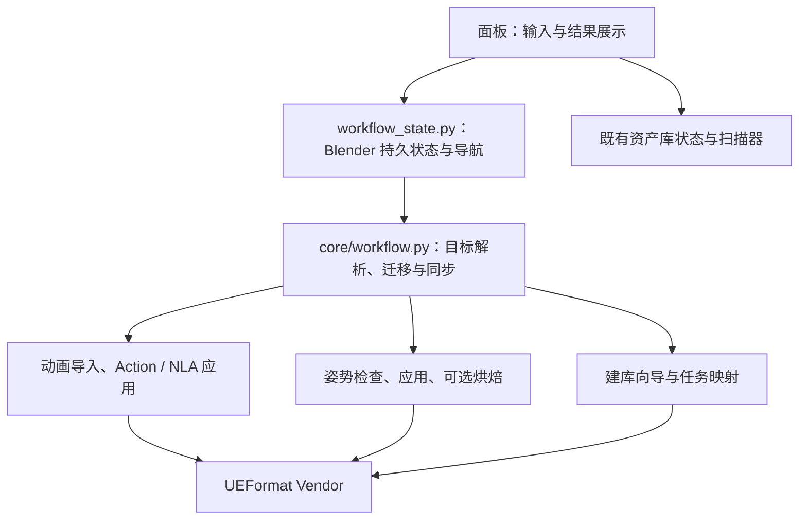

# 工作流架构与面板设计（2026-09-16）

本次改动统一工作目标和操作入口，减少面板层级，保持 UEFormat 解析、资产存储和管线阶段的现有边界。没有修改 Vendor 格式定义，也没有将姿势源改回强制形态键输出。

## 面板从上到下

| 区域 | 内容 | 默认行为 |
| --- | --- | --- |
| 当前工作对象 | 固定目标骨架、拾取按钮、当前库选择、最近导入结果摘要 | 展开 |
| 导入与建库 | UEMODEL、UEANIM、UEPOSE 快速导入；批量建库开关 | 折叠 |
| 批量建立动画库 | 来源 → 扫描与匹配 → 建立资产库 | 按需显示，独立于导入区折叠状态 |
| 资产浏览 | 模型 / 动画 / 姿势切换；搜索、列表、详情、操作 | 展开，仅显示所选类型 |
| 保存与库管理 | 保存目标模型、保存姿势源库、添加路径、索引扫描、库维护 | 折叠 |
| 辅助工具 | 网格、骨架、动画清理 | 折叠 |
| 设置与诊断 | Vendor 状态、详细操作报告、当前磁盘检查点导出 | 折叠 |

模型卡片按侧栏宽度显示 1–3 列；提供名称搜索。模型的磁盘删除操作移到“更多操作”。动画列表/卡片只负责选择，执行集中在详情下方；显示设置仅控制布局，引用方式和骨架校验位于应用区域，NLA 参数位于 NLA 展开区。移除了会直接替换 Action 却缺少恢复入口的列表预览按钮，原操作符仍供兼容调用。

动画默认浏览当前库，可以显式切换为全部扫描结果；扫描场景动作时切换到全部范围。姿势列表明确标注为当前场景保存的源资产，源库单独加载/保存，不把磁盘动画库选择伪装成姿势库过滤。

## 状态与模块边界



- `Scene.fmodel_workflow.target` 是当前工作目标的唯一权威字段，保存对象指针。重命名仍指向同一对象；选择相机、网格或另一个骨架不会改变目标。
- 清空、删除或从场景移除目标后，操作不能回退到当前选择。必须显式指定新目标。
- `core/workflow.py` 不导入 Blender、执行操作符或读写文件。`workflow_state.py` 负责属性注册、更新回调、载入迁移和工作区导航。
- 旧 `pipeline_wizard.import_target_skeleton` 与 `fmodel_pose_library.target` 保留为兼容字段；姿势旧字段的显式写入会同步到共享目标。
- 首次打开旧工程时，迁移依次选择已保存工作目标、管线目标、姿势目标。迁移完成后即使目标被清空，也不会自动从旧字段恢复。
- 单骨架映射与共享目标一致；多骨架任务各自保留显式目标。更换共享目标不覆盖多骨架映射。
- 当前库继续由已有 `fmodel_assets.project_libs/active_lib_index` 管理，不新增另一份库路径状态。
- 新根模块 `workflow_state.py` 已加入发布同步脚本的运行文件清单。

## 建库导航与状态失效

界面只有三个步骤，持久化仍使用旧步骤编号 2、3、4。旧编号 1 显示为来源页，保持旧工程可打开。

- 回看来源或扫描结果只切换页面，不清除结果。
- 修改来源目录、输出目录、库名称、骨架过滤仍触发现有失效处理。
- 更换工作目标保留来源扫描，清除导入/建库完成标记。
- 重新扫描先清除扫描/完成标记，失败后不会继续显示旧成功状态。
- 单骨架缺少目标、多骨架映射不完整时不能执行建立资产库。
- 完成页提供浏览资产、重新扫描、调整构建设置和重新开始。
- 向导配置在边界处通过 `bpy.path.abspath` 解析相对路径；扫描和诊断优先读取磁盘检查点。新场景无需事先创建 `PipelineContext` Text。
- 诊断中的“清除旧版场景缓存”只删除旧 Text，文字明确告知磁盘检查点仍保留。

## 使用路径

首次建立角色动画库：导入模型 → 确认顶部目标 → 开启批量建库 → 选择来源与输出 → 扫描并匹配 → 建立库 → 浏览动画资产。

日常使用：确认顶部目标和资产库 → 选择资产类型 → 搜索并选中资产 → 应用到骨架或插入 NLA。姿势的形态键烘焙仍是单独的可选操作。

## 验证与范围

运行纯 Python 回归：

```powershell
python -B -m pytest tests -q -p no:cacheprovider --basetemp <独立临时目录>
```

运行隔离 Blender 验收：

```text
blender --background --factory-startup --python-exit-code 1 --python scripts/blender_workflow_smoke.py
blender --background --factory-startup --python-exit-code 1 --python scripts/blender_pose_asset_smoke.py
```

工作流验收覆盖固定目标、重命名/删除、旧字段迁移、相对路径新场景扫描、返回上一步、建立库、应用到非活动目标、库目录边界、面板调用的真实 RNA 属性/操作符、场景重新载入及注册注销。面板绘制使用真实 RNA 加记录式布局检查，不是 GUI 截图验收。

本次不是对先前模块审查问题的全面修复：模型保存的网格完整性、辅助曲线打包、时间基准/重定向、库分卷维护和大规模性能仍应按原审查报告分别处理。“重建库与缩略图”保留现有重新发布行为，界面已明确说明会涉及库文件，不能视作仅更新图片。未新增无损动画预览/恢复功能，也未自动安装到用户 Blender。

验收结果：546 项测试与 51 个子测试通过；最后的库切换改动另通过 30 项相关测试与 3 个子测试。Blender 5.2.1 的工作流及姿势验收通过，Vendor 73 个文件校验通过。详见 [验证记录](compose/reports/2026-09-16-workflow-validation.json)。
